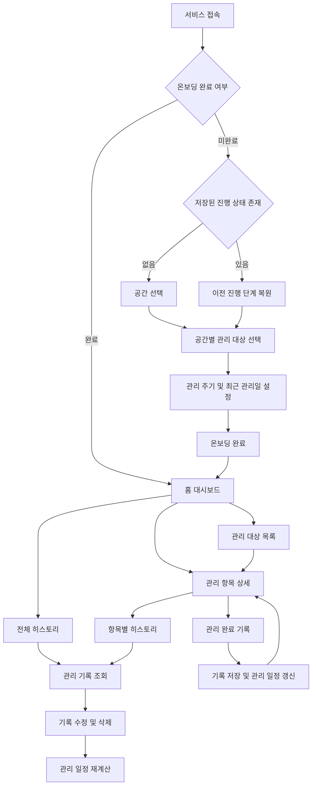

## 1. 문서 개요

### 1.1 목적

본 문서는 자취생을 위한 주거 관리 서비스의 사용자 흐름(User Flow)을 정의합니다.

사용자가 서비스를 처음 방문하는 순간부터 관리 대상을 등록하고 관리 주기를 확인하며 관리 이력을 기록하는 과정을 설명합니다.

본 문서는 기능 명세 및 아키텍처 설계의 기준으로 활용합니다.

### 1.2 서비스 핵심 기능

| 기능           | 설명                                       |
| -------------- | ------------------------------------------ |
| 관리 대상 등록 | 공간별 기본 관리 항목 선택 및 직접 등록    |
| 관리 주기 관리 | 권장 주기 설정 및 다음 관리 예정일 확인    |
| 관리 히스토리  | 관리 완료 기록 및 과거 기록 조회·수정·삭제 |

### 1.3 설계 원칙

- 모바일 환경을 우선으로 설계합니다.
- 처음 사용하는 사람도 쉽게 이해할 수 있는 흐름을 제공합니다.
- 초기 설정 과정에서 불필요한 입력을 최소화합니다.
- 사용자가 관리 주기를 모르더라도 서비스를 이용할 수 있도록 지원합니다.
- 사용자에게 확인되지 않은 날짜나 관리 이력을 임의로 생성하지 않습니다.

---

## 2. 전체 사용자 플로우

---

## 3. 온보딩 플로우

### 3.1 진입 조건

- 사용자가 서비스를 처음 방문한 경우
- 이전에 온보딩을 완료하지 않은 경우

온보딩을 완료한 사용자는 홈 대시보드로 이동합니다.

온보딩 도중 이탈한 사용자는 저장된 진행 상태를 복원합니다.

### 3.2 STEP 1. 공간 선택

**사용자 행동**

1. 온보딩 화면에 진입합니다.
2. 자신의 집에 해당하는 공간을 선택합니다.
3. 여러 공간을 동시에 선택할 수 있습니다.
4. 선택을 완료하면 다음 단계로 이동합니다.

**시스템 동작**

- 선택한 공간을 임시 저장합니다.
- 최소 1개 이상의 공간을 선택해야 다음 단계로 이동할 수 있습니다.
- 선택한 공간을 기준으로 관리 대상 목록을 구성합니다.

**공간 예시**

- 주방
- 욕실
- 침실
- 거실
- 세탁 공간
- 현관

실제 제공할 공간 목록은 추후 확정합니다.

### 3.3 STEP 2. 관리 대상 선택

**사용자 행동**

1. 첫 번째 선택 공간의 관리 대상 목록을 확인합니다.
2. 서비스에서 제공하는 기본 관리 항목을 선택합니다.
3. 목록에 없는 관리 대상은 직접 추가할 수 있습니다.
4. 해당 공간의 선택을 완료하면 다음 공간으로 이동합니다.
5. 선택한 모든 공간의 등록을 마치면 다음 단계로 이동합니다.

**시스템 동작**

- 선택된 공간을 순서대로 표시합니다.
- 공간별 기본 관리 항목을 제공합니다.
- 직접 등록한 항목을 해당 공간에 연결합니다.
- 사용자의 선택 내용을 임시 저장합니다.
- 전체 공간에서 최소 1개 이상의 관리 대상을 등록해야 합니다.

**예시**

주방을 선택한 사용자는 주방 후드 필터, 싱크대 배수구, 냉장고 등의 기본 관리 항목을 선택할 수 있습니다.

### 3.4 STEP 3. 관리 주기 설정

**사용자 행동**

1. 선택한 관리 대상의 관리 주기를 확인합니다.
2. 기본 항목에는 서비스가 제공하는 권장 주기가 적용됩니다.
3. 필요한 경우 관리 주기를 직접 수정합니다.
4. 최근 관리일을 알고 있다면 날짜를 입력합니다.
5. 최근 관리일을 모르는 경우 입력하지 않고 진행할 수 있습니다.
6. 설정을 완료하면 홈 대시보드로 이동합니다.

**시스템 동작**

- 기본 관리 항목에 권장 관리 주기를 적용합니다.
- 권장 주기는 제품과 사용 환경에 따라 달라질 수 있음을 안내합니다.
- 최근 관리일이 존재하면 다음 관리 예정일을 계산합니다.
- 최근 관리일이 없으면 '미설정' 상태로 저장합니다.
- 최근 관리일이 없는 항목에는 임의의 관리 예정일을 생성하지 않습니다.

직접 등록한 관리 대상의 주기 입력 방식은 기능 명세 단계에서 확정합니다.

### 3.5 온보딩 중 이탈

**발생 상황**

사용자가 온보딩을 완료하지 않고 브라우저를 종료하거나 페이지를 벗어난 경우

**시스템 동작**

1. 현재 진행 단계와 입력 내용을 자동 저장합니다.
2. 사용자가 재방문하면 저장된 진행 상태를 확인합니다.
3. 마지막으로 진행하던 단계와 입력 내용을 복원합니다.
4. 사용자는 이어서 온보딩을 진행할 수 있습니다.

---

## 4. 홈 대시보드 플로우

### 4.1 진입 조건

온보딩을 완료한 사용자가 서비스에 접속하거나 하단 홈 탭을 선택한 경우

### 4.2 사용자 행동

1. 홈 대시보드에 진입합니다.
2. 관리가 필요한 항목을 확인합니다.
3. 관리 예정일이 가까운 항목을 확인합니다.
4. 원하는 항목을 선택하여 상세 화면으로 이동합니다.
5. 하단 탭을 통해 관리 대상 목록 또는 전체 히스토리로 이동합니다.

### 4.3 시스템 동작

- 관리 예정일을 기준으로 관리 상태를 구분합니다.
- 관리가 필요한 항목을 우선적으로 표시합니다.
- 예정일이 지난 항목을 구분하여 표시합니다.
- 최근 관리일이 없는 항목은 '미설정'으로 표시합니다.
- 관리 기록이 변경되면 홈 대시보드의 상태를 갱신합니다.

관리 상태의 구체적인 분류 기준은 기능 명세 단계에서 정의합니다.

---

## 5. 관리 대상 조회 및 수정 플로우

### 5.1 관리 대상 목록

**진입 경로**

하단 내비게이션 → 관리 대상

**사용자 행동**

1. 등록된 전체 관리 대상을 확인합니다.
2. 공간별로 관리 대상을 조회합니다.
3. 원하는 관리 항목을 선택합니다.
4. 관리 항목 상세 화면으로 이동합니다.
5. 필요한 경우 새로운 관리 대상을 추가합니다.

### 5.2 관리 항목 상세

**진입 경로**

- 홈 대시보드 → 관리 항목 선택
- 관리 대상 목록 → 관리 항목 선택
- 전체 히스토리 → 관련 관리 항목 선택

**표시 정보**

- 관리 대상 이름
- 소속 공간
- 모델명 및 규격 등 등록된 상세 정보
- 관리 주기
- 최근 관리일
- 다음 관리 예정일
- 관리 상태
- 항목별 관리 히스토리

**사용자 행동**

1. 관리 대상의 상세 정보를 확인합니다.
2. 필요한 경우 관리 정보를 수정합니다.
3. 관리 완료 기록 화면으로 이동합니다.
4. 해당 항목의 과거 관리 기록을 확인합니다.
5. 필요한 경우 관리 대상을 삭제합니다.

### 5.3 관리 대상 삭제

1. 사용자가 관리 대상 삭제를 선택합니다.
2. 관련 히스토리도 삭제된다는 안내를 표시합니다.
3. 사용자가 삭제를 확인하면 해당 관리 대상과 관련 기록을 삭제합니다.
4. 관리 대상 목록 및 홈 대시보드를 갱신합니다.

---

## 6. 관리 완료 기록 플로우

### 6.1 진입 경로

관리 항목 상세 → 관리 완료 기록

### 6.2 사용자 행동

1. 관리 완료 기록 화면에 진입합니다.
2. 실제 관리를 진행한 날짜를 입력합니다.
3. 필요한 경우 사용한 청소 제품 또는 교체 부품을 입력합니다.
4. 필요한 경우 관리 메모를 작성합니다.
5. 저장 버튼을 선택합니다.

### 6.3 입력 정보

| 항목                   | 필수 여부 |
| ---------------------- | --------- |
| 관리 날짜              | 필수      |
| 사용 제품 및 교체 부품 | 선택      |
| 관리 메모              | 선택      |

### 6.4 시스템 동작

1. 입력값을 검증합니다.
2. 관리 히스토리에 새로운 기록을 추가합니다.
3. 기록된 관리일을 기준으로 최근 관리일을 갱신합니다.
4. 관리 주기에 따라 다음 관리 예정일을 계산합니다.
5. 홈 대시보드의 관리 상태를 갱신합니다.
6. 저장 결과를 사용자에게 안내합니다.

과거 날짜로 기록하는 경우에도 가장 최근의 유효한 관리 기록을 기준으로 일정을 계산합니다.

---

## 7. 관리 히스토리 플로우

### 7.1 항목별 히스토리

**진입 경로**

관리 항목 상세 → 항목별 히스토리

**사용자 행동**

1. 해당 관리 대상의 과거 기록을 확인합니다.
2. 기록을 날짜순으로 조회합니다.
3. 특정 기록을 선택합니다.
4. 기록 내용을 확인하거나 수정·삭제합니다.

### 7.2 전체 히스토리

**진입 경로**

하단 내비게이션 → 히스토리

**사용자 행동**

1. 모든 관리 대상의 기록을 확인합니다.
2. 기록을 날짜순으로 조회합니다.
3. 특정 기록을 선택합니다.
4. 해당 기록을 확인하거나 수정·삭제합니다.

### 7.3 관리 기록 수정

1. 사용자가 기존 관리 기록을 선택합니다.
2. 수정할 정보를 변경합니다.
3. 수정 내용을 저장합니다.
4. 시스템은 변경된 기록을 저장합니다.
5. 관련 관리 대상의 최근 관리일을 다시 계산합니다.
6. 다음 관리 예정일과 홈 관리 상태를 갱신합니다.

### 7.4 관리 기록 삭제

1. 사용자가 기록 삭제를 선택합니다.
2. 삭제 확인을 요청합니다.
3. 사용자가 확인하면 해당 기록을 삭제합니다.
4. 남은 기록을 기준으로 최근 관리일을 다시 계산합니다.
5. 다음 관리 예정일과 홈 관리 상태를 갱신합니다.

모든 기록이 삭제되어 최근 관리일을 확인할 수 없는 경우 '미설정' 상태로 변경합니다.

---

## 8. 내비게이션 구조

서비스는 모바일 우선 하단 탭 내비게이션을 사용합니다.

| 탭        | 주요 기능                        |
| --------- | -------------------------------- |
| 홈        | 관리 현황 및 관리 필요 항목 확인 |
| 관리 대상 | 공간별 관리 대상 조회 및 등록    |
| 히스토리  | 전체 관리 기록 조회              |

관리 항목 상세와 관리 완료 기록은 하단 탭에서 진입하는 하위 화면으로 구성합니다.

### 페이지 경로 초안

| 화면           | 경로                    |
| -------------- | ----------------------- |
| 온보딩         | `/onboarding`           |
| 홈 대시보드    | `/`                     |
| 관리 대상 목록 | `/items`                |
| 관리 항목 상세 | `/items/:itemId`        |
| 관리 완료 기록 | `/items/:itemId/record` |
| 전체 히스토리  | `/history`              |

위 경로는 설계 초안이며 아키텍처 설계 과정에서 변경될 수 있습니다.

---

## 9. 예외 상황 처리

| 상황                | 처리 방식                        |
| ------------------- | -------------------------------- |
| 온보딩 도중 이탈    | 진행 상태 자동 저장 및 복원      |
| 공간 미선택         | 최소 1개 이상 선택하도록 안내    |
| 관리 대상 미선택    | 최소 1개 이상 등록하도록 안내    |
| 최근 관리일 미입력  | 미설정 상태 유지                 |
| 관리 예정일 경과    | 관리 필요 항목으로 표시          |
| 관리 기록 수정      | 관련 관리 일정 재계산            |
| 관리 기록 삭제      | 남은 기록을 기준으로 일정 재계산 |
| 관리 기록 전체 삭제 | 최근 관리일 미설정 처리          |
| 관리 대상 삭제      | 관련 히스토리 삭제 안내 후 확인  |
| 저장 실패           | 오류 안내 및 재시도 지원         |

---

## 10. 추후 결정 사항

다음 항목은 기능 명세 및 아키텍처 설계 과정에서 확정합니다.

- [ ] 기본 공간 및 관리 항목 목록
- [ ] 관리 항목별 권장 관리 주기
- [ ] 직접 등록 항목의 필수 입력값
- [ ] 관리 상태 및 시급도 분류 기준
- [ ] 관리 정보 수정 화면 구성
- [ ] 관리 기록 수정·삭제 UI 방식
- [ ] 데이터 저장 및 복원 방식
- [ ] 사용자 데이터 유지 정책
- [ ] 세부 라우팅 구조

---

## 11. 관련 문서

- `README.md`: 프로젝트 소개
- `AGENTS.md`: AI 개발 작업 규칙
- `src/docs/FUNCTIONAL_SPEC.md`: 기능 명세서 (작성 예정)
- `src/docs/ARCHITECTURE.md`: 아키텍처 설계 문서 (작성 예정)

본 문서는 사용자 플로우 또는 서비스 요구사항이 변경될 경우 함께 업데이트합니다.
